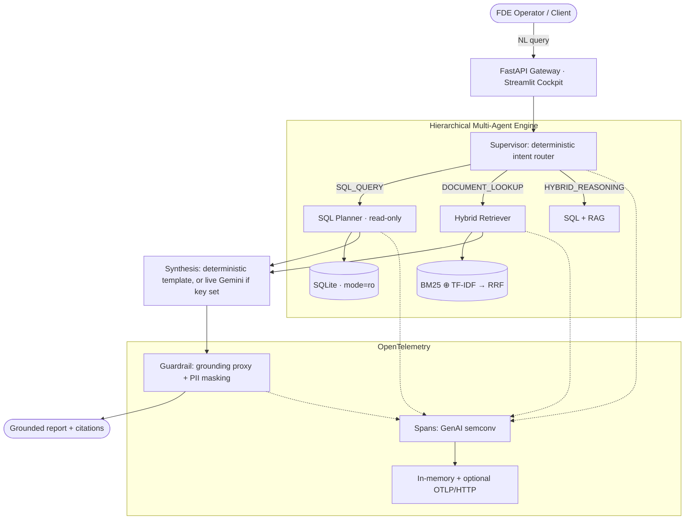

# 🛡️ NexusOps — Forward-Deployed Enterprise Agentic Gateway

> A multi-agent enterprise gateway that answers operational questions over
> **structured** (SQLite incident/account data) and **unstructured** (Cloud SLA &
> policy docs) sources — with hybrid retrieval, read-only SQL planning, grounding
> guardrails, and OpenTelemetry GenAI telemetry.
>
> **Offline-first:** every component runs deterministically with **no API key and
> no network** — so the demo never flakes. A live Gemini path is opt-in.

<p>


</p>

---

## ✨ Why this project is different

Most "agentic RAG" demos either need a paid API key to run at all, or hide
keyword matching behind words like *semantic* and *synthesis*. NexusOps is built
the opposite way — **honest and reproducible**:

| Claim | What it actually is | Honest? |
|---|---|---|
| Hybrid retrieval | **Real Okapi BM25** + **real TF-IDF cosine**, fused with **RRF (k=60)**, computed on numpy | ✅ exact, textbook |
| SQL agent | **Deterministic schema-aware planner** → vetted read-only `SELECT` templates, executed on a `mode=ro` connection | ✅ zero injection surface |
| Intent routing | Deterministic keyword classifier (fast, free, auditable) | ✅ named as such |
| Grounding guardrail | Transparent **token-overlap proxy** + regex PII masking | ✅ labelled a proxy |
| Token / cost accounting | **Estimated** from real text (~4 chars/token) in offline mode | ✅ labelled estimated |
| OpenTelemetry | Real spans on GenAI semantic conventions; **real OTLP/HTTP export** when a collector is configured | ✅ |

Nothing here pretends to be a neural model or a live LLM call when it isn't.

---

## 🏛️ Architecture



**Pipeline:** classify intent → retrieve (BM25+TF-IDF+RRF) and/or plan+run SQL →
synthesize → verify grounding + mask PII → record span & metrics.

---

## 🚀 Quickstart (offline — no API key)

```bash
git clone https://github.com/The-AnkitPatel/NexusOps.git
cd NexusOps

python -m venv .venv && . .venv/Scripts/activate   # Windows
# python -m venv .venv && source .venv/bin/activate # macOS/Linux

pip install -r requirements.txt     # or: pip install -e ".[dev]"
python data/init_db.py              # build the enterprise SQLite DB
```

Run it:

```bash
streamlit run ui/app.py                                 # interactive cockpit → :8501
uvicorn nexus.api.server:app --reload --port 8000       # REST gateway  → :8000/docs
```

Or with Docker:

```bash
docker compose up --build    # API :8000, UI :8501
```

> **Live Gemini (optional):** `pip install ".[llm]"`, set `GEMINI_API_KEY` in
> `.env`, and synthesis switches from the deterministic template to live Gemini.
> Everything else is unchanged.

---

## 🧪 Quality gates

```bash
make check      # == ruff check . && mypy && pytest
```

- **27 tests** (`pytest`) covering BM25/TF-IDF correctness, RRF retrieval,
  read-only SQL guardrails (incl. engine-level write rejection), intent routing,
  the FastAPI contract, and OTel span emission.
- **ruff** (lint + import order + format) and **mypy** (typed `nexus/` package).
- **GitHub Actions** runs all of the above on Python 3.11 & 3.12 and builds the
  Docker image on every push/PR.
- **pre-commit** mirrors the CI hooks locally (`make dev`).

---

## 📊 Benchmarks

Measured on a 17-query labelled set (`evals/gold.json`) — fully offline, deterministic:

<!-- benchmarks:start -->

| Metric | Value |
|---|---|
| Dataset size | 17 queries |
| Intent routing accuracy | 88% |
| Retrieval Precision@1 | 92% |
| Retrieval Recall@3 | 100% |
| Retrieval MRR | 0.962 |
| SQL success rate | 100% |
| Grounding pass rate | 94% |
| Mean latency | 0.51 ms |
| p95 latency | 0.96 ms |

_Reproduce: `make eval`. Fully offline, no API key._

<!-- benchmarks:end -->

> **Honest limitation the eval surfaces:** intent routing is a keyword heuristic, so
> product names like "Cloud **SQL**" and severities like "**P1**" occasionally
> over-trigger the SQL path (it still retrieves the right policy — it just does
> extra work). This is exactly what the optional live-Gemini router improves; the
> deterministic router stays as the zero-cost, zero-dependency default.

---

## 📡 API

| Method | Path | Purpose |
|---|---|---|
| `POST` | `/v1/agent/query` | Run the multi-agent pipeline; returns full `NexusState` with citations, SQL, trace, tokens & cost |
| `GET` | `/v1/telemetry/metrics` | p50/p95/p99 latency, total tokens, cost, guardrail-intercept rate |
| `GET` | `/v1/telemetry/traces` | Recent execution trace summaries |
| `GET` | `/v1/health` | Status, version, execution mode, OTLP state |

```bash
curl -s localhost:8000/v1/agent/query \
  -H 'content-type: application/json' \
  -d '{"query":"Does Apollo qualify for an SLA credit on their P1 Cloud SQL ticket?"}'
```

---

## ⚙️ Configuration

All optional — the gateway runs with none set. See [`.env.example`](.env.example).

| Variable | Default | Notes |
|---|---|---|
| `GEMINI_API_KEY` | *(empty)* | Set → live Gemini synthesis (`pip install ".[llm]"`) |
| `NEXUS_MODEL` | `gemini-2.5-flash` | Synthesis model |
| `GEN_AI_SYSTEM` | `gemini` | GenAI semconv system id (`gemini` / `vertex_ai`) |
| `OTEL_EXPORTER_OTLP_ENDPOINT` | *(empty)* | Set → OTLP/HTTP export (`pip install ".[otlp]"`) |
| `LOG_LEVEL` | `INFO` | JSON structured logs |
| `DATABASE_PATH` / `POLICIES_PATH` | `data/...` | Data sources |

---

## 🗂️ Layout

```
nexus/
  agents/       supervisor · sql_agent (read-only planner) · retriever · guardrail
  rag/          hybrid_search (Okapi BM25 + TF-IDF cosine + RRF) · document_store
  telemetry/    tracer (OTel + OTLP) · metrics · cost_calculator (token estimate)
  api/          FastAPI server + routes
  config.py     typed settings   ·   logging.py   structured JSON logs   ·   state.py
tests/          27 tests (agents · hybrid search · SQL guardrails · telemetry · API)
ui/app.py       Streamlit cockpit
data/           init_db.py · enterprise_policies.json
```

---

## 🗺️ Roadmap

- Swap the TF-IDF dense channel for real embeddings (Vertex AI / `text-embedding`)
  behind the same `HybridRetriever` interface.
- Replace the keyword router + SQL planner with Gemini function-calling, keeping
  the deterministic path as a guaranteed fallback.
- Ship spans to Google Cloud Trace via the OpenTelemetry Collector.

---

## 📄 License

Apache-2.0 © 2026 Ankit Kumar Patel
