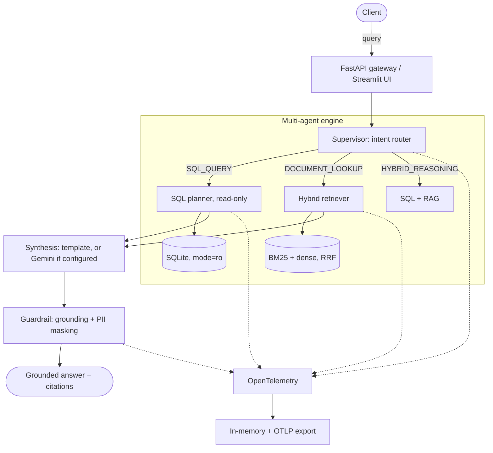

# NexusOps

A multi-agent gateway that answers enterprise operations questions over both
structured data (incident/account SQL) and unstructured data (SLA and policy
documents), with hybrid retrieval, read-only SQL planning, grounding guardrails,
and OpenTelemetry telemetry.

Runs fully offline with no API key; a live Gemini path is opt-in.

<p>


</p>

## Overview

A query is classified into one of three intents, dispatched to the relevant
agents, synthesized into a grounded answer, and traced end to end:

- **Retrieval**: Okapi BM25 + a pluggable dense channel (TF-IDF cosine by default,
  Gemini embeddings opt-in), fused with Reciprocal Rank Fusion.
- **SQL**: a schema-aware planner that maps intents to vetted `SELECT` templates
  and runs them on a read-only connection (no LLM-generated SQL).
- **Guardrails**: token-overlap grounding check and regex PII masking.
- **Telemetry**: OpenTelemetry spans (GenAI conventions), Prometheus metrics, and
  per-query token/cost accounting.

## Architecture



## Quickstart

```bash
python -m venv .venv && . .venv/Scripts/activate   # Windows
pip install -r requirements.txt
python data/init_db.py
```

```bash
uvicorn nexus.api.server:app --port 8000     # API + docs at :8000/docs
streamlit run ui/app.py                      # UI at :8501
```

Or with Docker (API, UI, OpenTelemetry Collector, Jaeger):

```bash
docker compose up --build
```

Live Gemini (optional): `pip install ".[llm]"`, set `GEMINI_API_KEY`, and routing,
synthesis, and embeddings switch to Gemini with the offline path kept as fallback.

## API

| Method | Path | Description |
|---|---|---|
| `POST` | `/v1/agent/query` | Run the pipeline; returns the full state with citations, SQL, trace, tokens, cost |
| `POST` | `/v1/agent/query/stream` | Same pipeline streamed as Server-Sent Events |
| `GET` | `/v1/telemetry/metrics` | Latency percentiles, tokens, cost, guardrail rate |
| `GET` | `/v1/telemetry/traces` | Recent execution-trace summaries |
| `GET` | `/v1/health` | Status, version, execution mode, embedder, OTLP state |
| `GET` | `/livez`, `/readyz` | Liveness and readiness probes |
| `GET` | `/metrics` | Prometheus metrics |

```bash
curl -s localhost:8000/v1/agent/query -H 'content-type: application/json' \
  -d '{"query":"Does Apollo qualify for an SLA credit on their P1 Cloud SQL ticket?"}'
```

## Configuration

All optional; the service runs with none set. See [`.env.example`](.env.example).

| Variable | Default | Notes |
|---|---|---|
| `GEMINI_API_KEY` | empty | Set to enable live Gemini (`pip install ".[llm]"`) |
| `NEXUS_MODEL` | `gemini-2.5-flash` | Synthesis / routing model |
| `OTEL_EXPORTER_OTLP_ENDPOINT` | empty | Set to export spans over OTLP (`pip install ".[otlp]"`) |
| `LOG_LEVEL` | `INFO` | JSON logs |
| `DATABASE_PATH` / `POLICIES_PATH` | `data/...` | Data sources |

## Observability

Spans follow OpenTelemetry GenAI semantic conventions and are captured in-memory
for the UI trace log. `docker compose up` also starts an OpenTelemetry Collector
and Jaeger:

```
gateway --OTLP--> OpenTelemetry Collector --OTLP--> Jaeger UI (:16686)
```

Prometheus request metrics are exposed at `/metrics`. Point
`OTEL_EXPORTER_OTLP_ENDPOINT` at any collector (including one fronting Google
Cloud Trace) to export there.

## Benchmarks

Measured on a 17-query labelled set (`evals/gold.json`), offline and deterministic:

<!-- benchmarks:start -->

| Metric | Value |
|---|---|
| Dataset size | 17 queries |
| Intent routing accuracy | 88% |
| Retrieval Precision@1 | 92% |
| Retrieval Recall@3 | 100% |
| Retrieval MRR | 0.962 |
| SQL success rate | 100% |
| Grounding pass rate | 94% |
| Mean latency | 0.53 ms |
| p95 latency | 0.98 ms |

_Reproduce: `make eval`. Fully offline, no API key._

<!-- benchmarks:end -->

Intent routing is a keyword heuristic, so product names like "Cloud SQL" and
severities like "P1" can route to the SQL path when a document lookup would do
(the correct policy is still retrieved). The optional Gemini router improves this.

## Development

```bash
pip install -e ".[dev]"
make check        # ruff + mypy + pytest
make eval         # run the evaluation harness
```

37 tests cover retrieval correctness, read-only SQL guardrails, the API contract,
telemetry, and the evaluation thresholds. CI runs lint, format, types, tests, and
a Docker build on Python 3.11 and 3.12.

## Layout

```
nexus/
  agents/       supervisor, sql_agent (read-only planner), retriever, guardrail
  rag/          hybrid_search (BM25 + RRF), embeddings (pluggable), document_store
  telemetry/    tracer (OTel/OTLP), metrics, prometheus, cost_calculator
  api/          FastAPI server, routes, error handlers
  config.py, logging.py, state.py
evals/          gold.json + run_eval.py
tests/          37 tests
ui/app.py       Streamlit UI
deploy/         otel-collector-config.yaml
data/           init_db.py, enterprise_policies.json
```

## License

Apache-2.0
