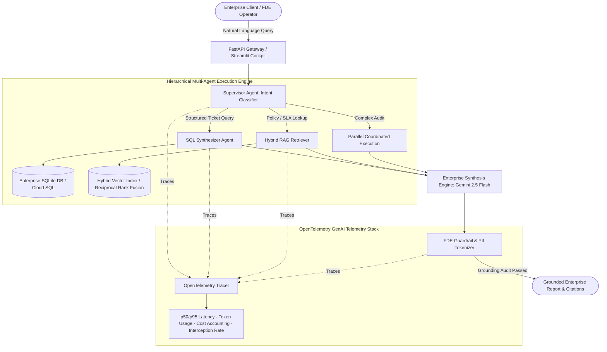

# 🛡️ NexusOps — Forward Deployed Enterprise Agentic Gateway

> **Engineered for Google Cloud Consulting (FDE Cohort 2027)**  
> Production-grade Autonomous Multi-Agent Orchestrator with OpenTelemetry GenAI Semantic Conventions, Hybrid RAG (Dense + BM25 RRF), Deterministic SQL Synthesis, and FDE Compliance Guardrails.

---

## 🏛️ System Architecture



---

## ⚡ Core Engineering Highlights

### 1. Hierarchical Multi-Agent Orchestration
* **Intent-Driven Routing:** Deterministic classification splits incoming queries into `SQL_QUERY`, `DOCUMENT_LOOKUP`, or `HYBRID_REASONING`.
* **Sub-Agent Specialization:**
  * **SQL Agent:** Enforces read-only database introspection with runtime DDL/DML injection blockers.
  * **Retriever Agent:** Executes Dense + Sparse (BM25) hybrid retrieval with **Reciprocal Rank Fusion (RRF $k=60$)** across enterprise SLA policies.
  * **Guardrail Agent:** Token-overlap grounding verification against retrieved evidence context, with automated PII regex tokenization (Emails, Credit Cards, Phone numbers).

### 2. OpenTelemetry GenAI Semantic Conventions
Native telemetry instrumentation conforming to modern OpenTelemetry GenAI specifications:
* `gen_ai.system`: `google_vertex_ai`
* `gen_ai.request.model`: `gemini-2.5-flash`
* `gen_ai.usage.prompt_tokens` & `gen_ai.usage.completion_tokens`
* `gen_ai.usage.cost_usd`: Dynamic cost calculation based on model pricing tokens.
* Full execution span trees tracking latency per agent step.

### 3. Enterprise Data Readiness
* **Structured Data:** In-memory SQLite production schema containing multi-tier enterprise accounts (`mrr_usd`, `assigned_fde`) and incident tickets (`P0-P3`, `downtime_minutes`, `service_impacted`).
* **Unstructured Data:** Google Cloud SLA commitments, PII masking standards (POL-SEC-002), and Severity-1 incident escalation protocols.

---

## 🚀 Quickstart

### 1. Installation
```bash
git clone https://github.com/The-AnkitPatel/NexusOps.git
cd NexusOps

# Install dependencies via uv or pip
uv venv .venv
.venv\Scripts\activate  # Windows
uv pip install -r requirements.txt

# Initialize Enterprise Database
python data/init_db.py
```

### 2. Run Tests
```bash
python -m pytest -v
```

### 3. Launch Interactive FDE Cockpit (Streamlit)
```bash
streamlit run ui/app.py
```

### 4. Launch FastAPI Gateway
```bash
python nexus/api/server.py
# Docs live at: http://localhost:8000/docs
```

---

## 📊 Telemetry Endpoints

* `POST /v1/agent/query`: Execute multi-agent pipeline and return verified state with citations.
* `GET /v1/telemetry/metrics`: Returns p50, p95, and p99 execution latencies, total token consumption, and cost tracking.
* `GET /v1/telemetry/traces`: Real-time OpenTelemetry span stream.

---

## 📄 License
Apache 2.0 © 2026 Ankit Kumar Patel
